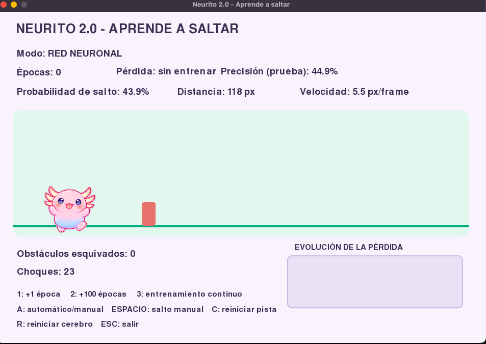
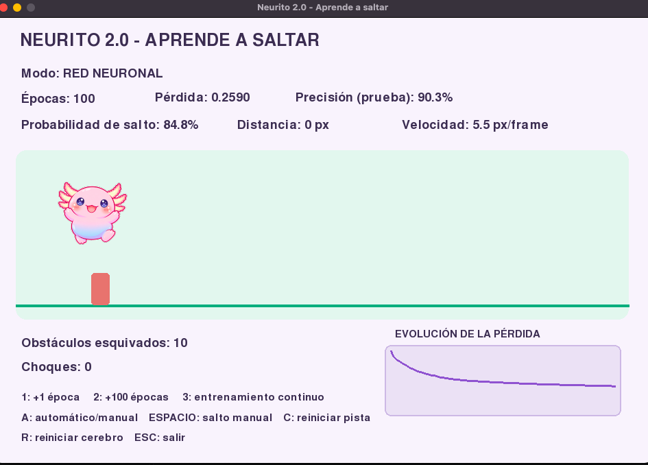
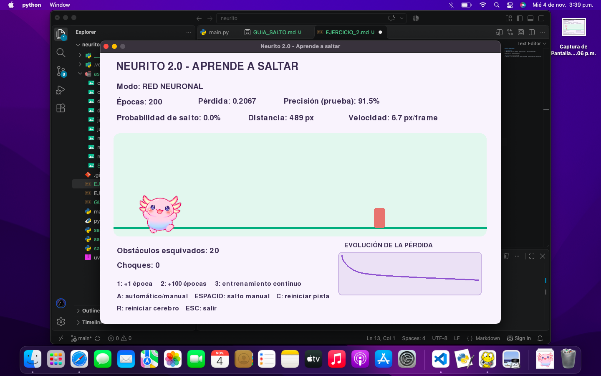
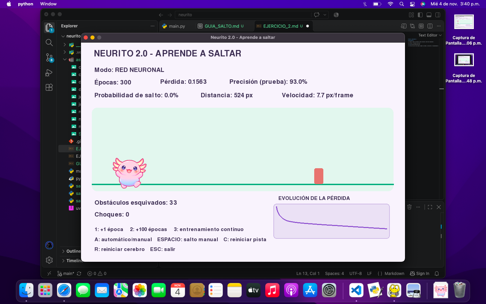
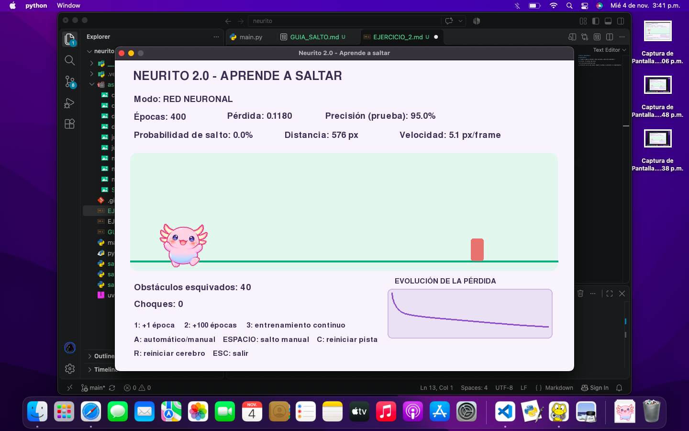
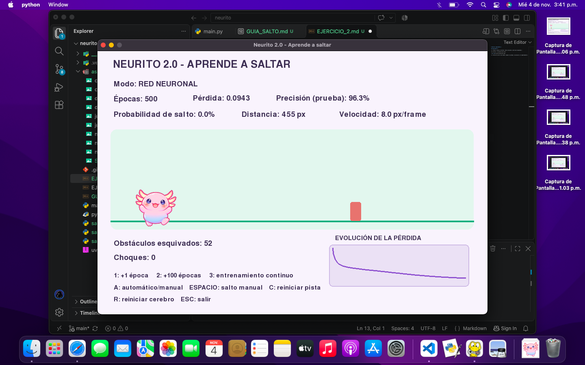
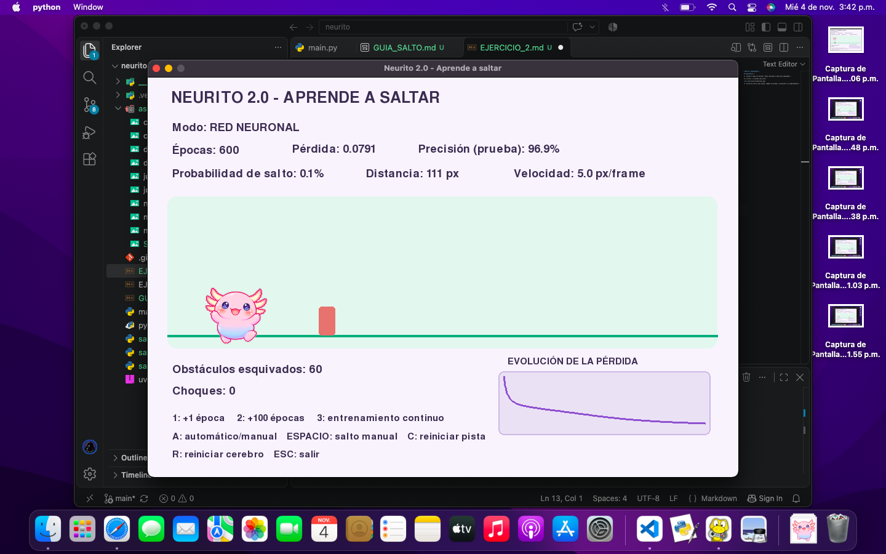
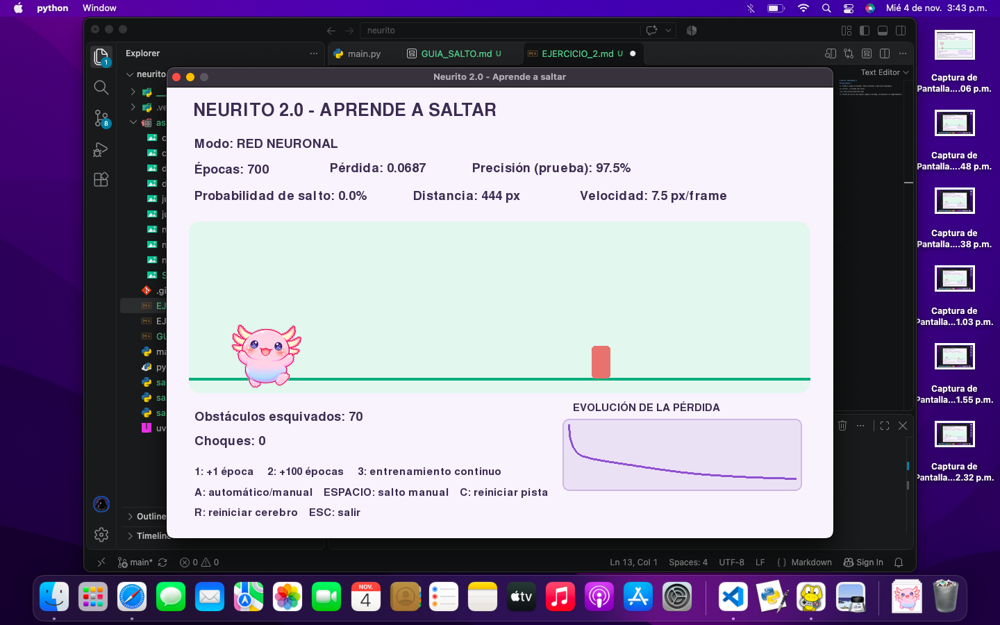
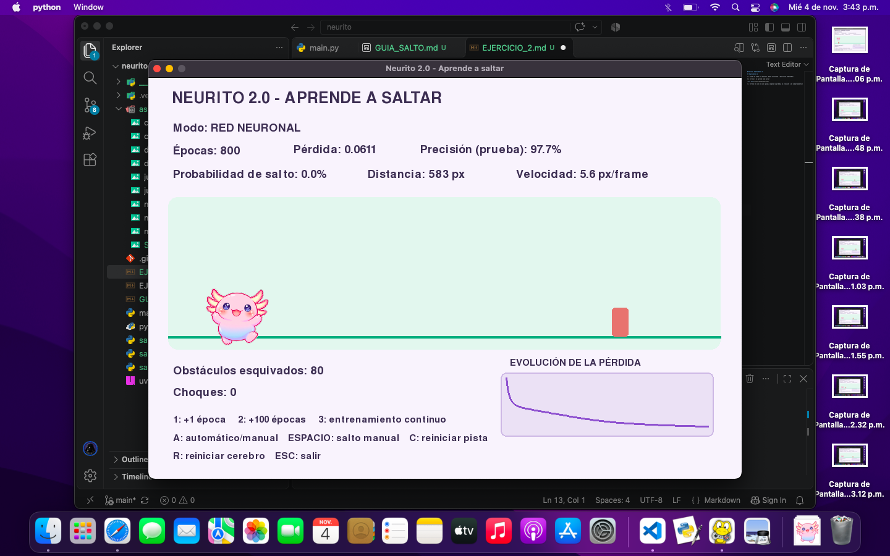

# Neurito: experimentos 2
 
## Experimentos 2

*1. Prueba el juego sin entrenar. Anota colisiones y obstáculos esquivados.*

Sin entrenar, no aprende como saltar

*2. Entrena de cien en cien épocas; compara la pérdida, la precisión y el comportamiento.*

       

En este caso, cada 100 se fue aumentando el porcentaje de precisión de la prueba, pero en la epoca 500 se noto que su porcentaje subio a 95.0%, pero al realizar sus 10 saltos con esta epoca subio progresivamente hasta llegar a 96.3%