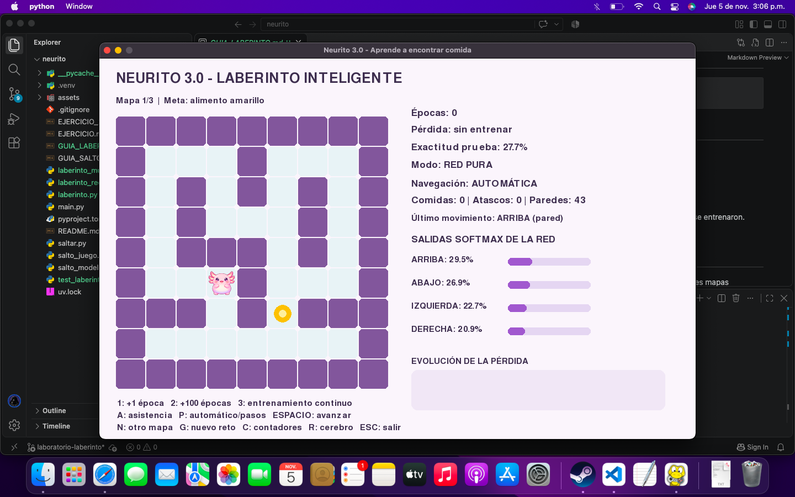
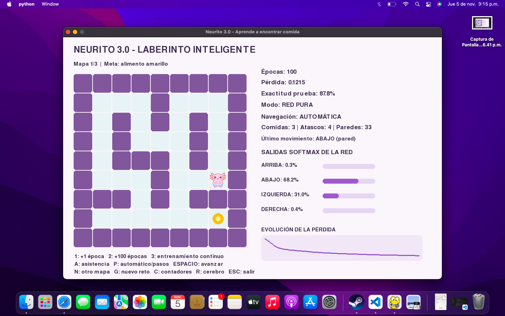
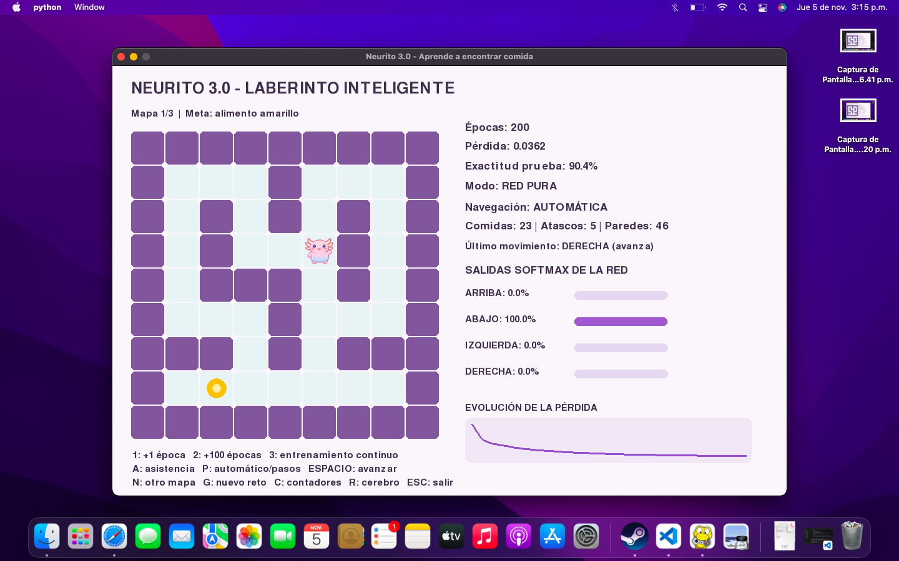
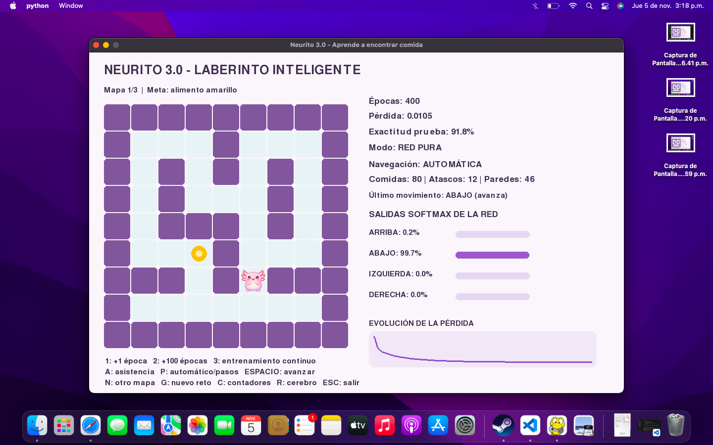
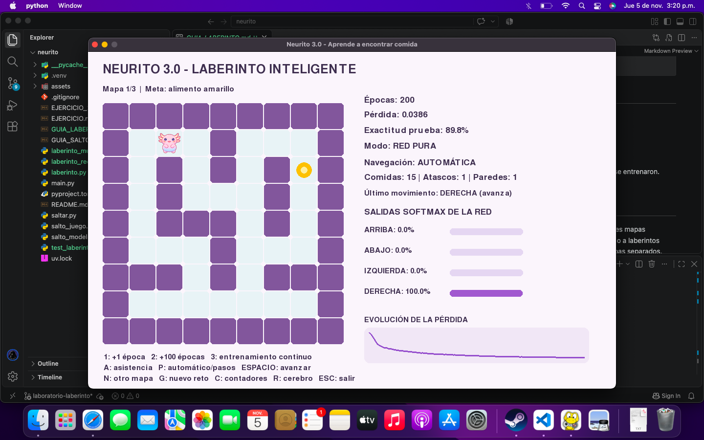
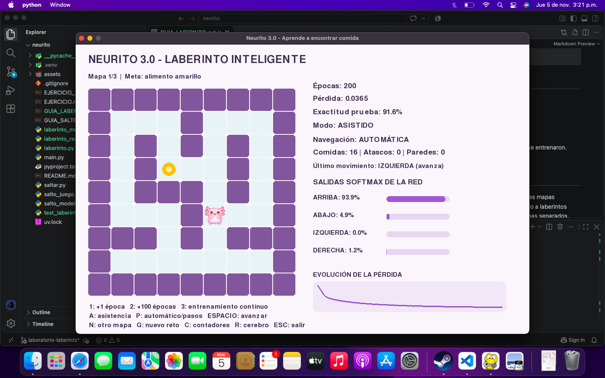
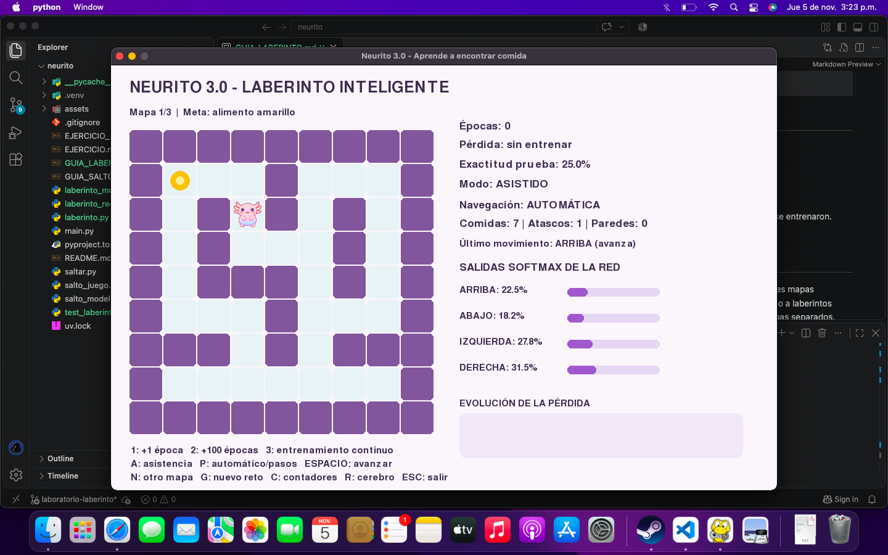
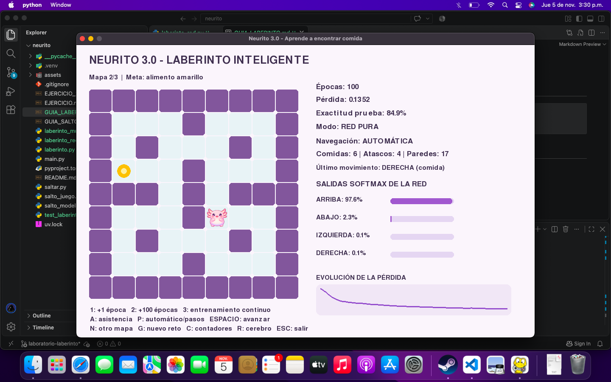
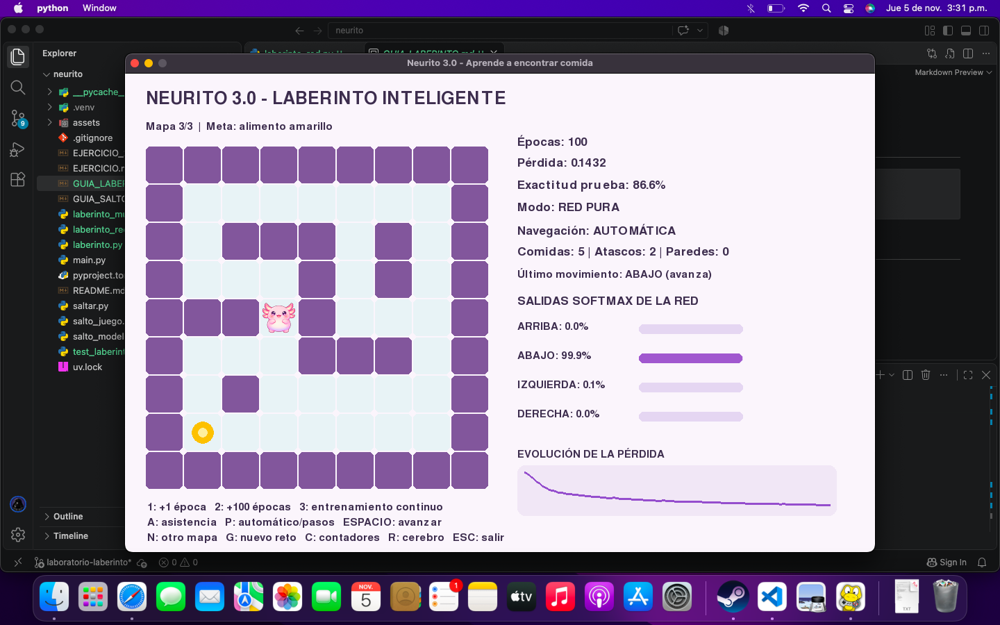

# Neurito 3.0: aprende a encontrar comida en un laberinto

*1. Observa Neurito sin entrenar. ¿Por qué se atasca?*

Sin entrenar, los pesos son aleatorios y la red da casi la misma probabilidad a las cuatro direcciones (29.5 %, 26.9 %, 22.7 % y 20.9 %), con una exactitud de 27.7 %. En red pura siempre escoge la más alta. Como al chocar con una pared Neurito no se mueve, la red recibe la misma posición y vuelve a escoger el mismo movimiento. Por eso choca una y otra vez (43 choques con la pared) hasta que se acaban los 45 intentos.

*2. Entrena 100, 200 y 400 épocas. Compara pérdida, precisión y movimientos.*

  

| Épocas | Pérdida | Exactitud | Comidas | Atascos | Paredes |
|---|---|---|---|---|---|
| 0 | Sin entrenar | 27.7 % | 0 | 0 | 43 |
| 100 | 0.1215 | 87.8 % | 3 | 4 | 33 |
| 200 | 0.0362 | 90.4 % | 23 | 5 | 46 |
| 400 | 0.0105 | 91.8 % | 80 | 12 | 46 |

*3. Compara red pura frente a navegación asistida. ¿Qué parte corresponde al modelo y cuál a las reglas?*

 

 

- **Red pura, 0 épocas:** 0 comidas y 29 paredes.
- **Red pura, 200 épocas:** 15 comidas, 1 atasco y 1 pared.
- **Asistido, 0 épocas:** 2 comidas, 1 atasco y 0 paredes.
- **Asistido, 200 épocas:** 16 comidas, 0 atascos y 0 paredes.

El **modelo** es la red: da la probabilidad de cada dirección según el mapa, la posición y la comida. Las **reglas** son las del modo asistido: no dejan moverse contra una pared y castigan las casillas ya visitadas. Por eso en asistido nunca choca con paredes, y aun sin entrenar alcanza a encontrar comida. Pero los mejores resultados salen cuando la red está entrenada y además se usan las reglas.

*4. Cambia las 96 neuronas ocultas por 16, 32 o 128.*

 

Con 200 épocas, en 300 retos en red pura:

- **16 neuronas:** pérdida de 0.0992, exactitud de 88.7 % y 208 comidas.
- **32 neuronas:** pérdida de 0.0630, exactitud de 87.4 % y 235 comidas.
- **96 neuronas:** pérdida de 0.0376, exactitud de 90.1 % y 247 comidas.
- **128 neuronas:** pérdida de 0.0366, exactitud de 89.2 % y 257 comidas.

*5. Cambia la tasa de aprendizaje 0.45 y observa si converge.*

Con 200 épocas:

- **Tasa 0.01:** pérdida de 1.0367 y exactitud de 66.5 %. No alcanza a converger, aprende muy lento. En el juego chocó 262 veces con las paredes.
- **Tasa 0.1:** pérdida de 0.2841 y exactitud de 82.7 %. Converge, pero lento.
- **Tasa 0.45 (original):** pérdida de 0.0376 y exactitud de 90.1 %. Converge bien.
- **Tasa 1.0:** pérdida de 0.0079 y exactitud de 93.2 %. Converge más rápido. En el juego encontró 48 comidas sin chocar.
- **Tasa 4.0:** pérdida de 0.3079 y exactitud de 67.3 %. Se vuelve inestable y no converge. En el juego solo encontró 2 comidas.

Una tasa muy baja aprende demasiado lento y una muy alta hace que los pesos salten y no converjan.

*6. Cambia de mapa. Los mapas forman parte del entrenamiento, pero las combinaciones de inicio y meta usadas para probar no se entrenaron.*

  

Con 100 épocas:

- **Mapa 1:** 5 comidas, 1 atasco y 8 paredes.
- **Mapa 2:** 6 comidas, 4 atascos y 17 paredes.
- **Mapa 3:** 5 comidas, 2 atascos y 0 paredes.

La exactitud de prueba estuvo entre 84.9 % y 86.6 %. Se mide con los tres mapas juntos, por eso es casi igual en todos.

*7. Haz vibecoding para verificar cómo mejora o empeora Neurito al cambiar DFS, por BFS y A\**

Con ayuda de IA hice el archivo `comparar_busquedas.py`, que entrena la red con cada algoritmo como profesor (200 épocas) y juega 300 retos:

- **BFS:** exactitud de 90.1 %, 247 comidas en red pura y 300 en asistido.
- **DFS:** exactitud de 99.9 %, pero solo 16 comidas en red pura y 127 en asistido.
- **A\*:** exactitud de 90.9 %, 257 comidas en red pura y 300 en asistido.

**BFS y A\*** encuentran el camino más corto, por eso Neurito aprende buenos movimientos. A\* llega al mismo resultado que BFS, pero se guía con la distancia hasta la comida. **DFS empeora mucho a Neurito:** no busca el camino más corto, sino el primero que encuentra, y sus caminos son en promedio 3 veces más largos. La red copió muy bien a DFS (99.9 %), pero como DFS enseña malos movimientos, Neurito da vueltas y casi no encuentra comida. Esto muestra que una precisión alta no sirve si el profesor enseña mal.